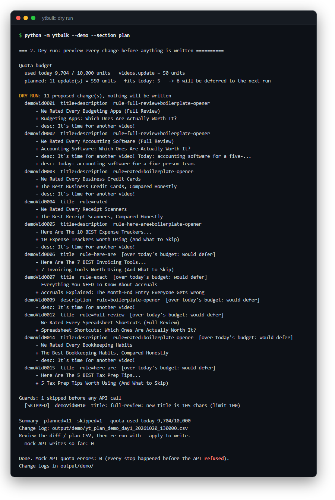
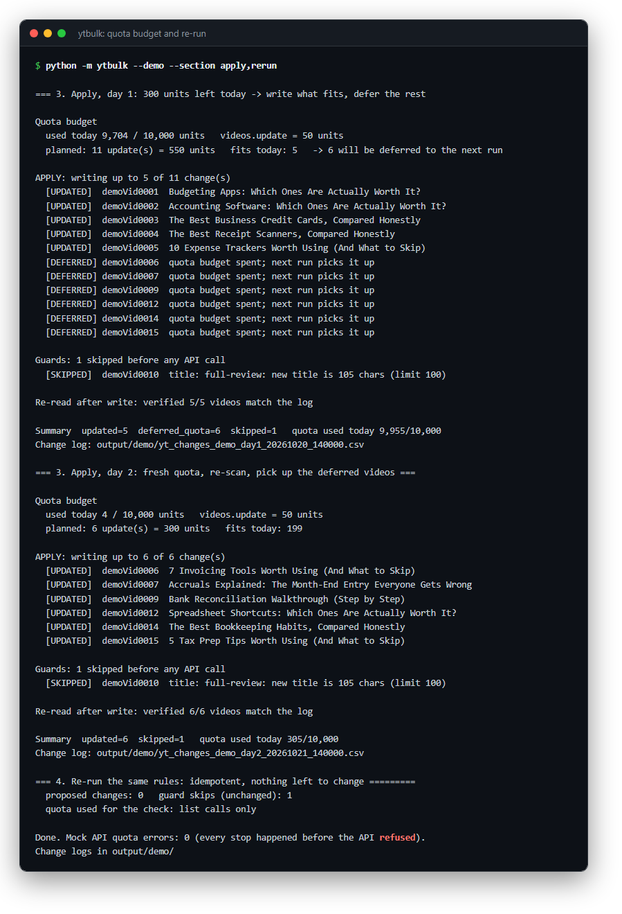
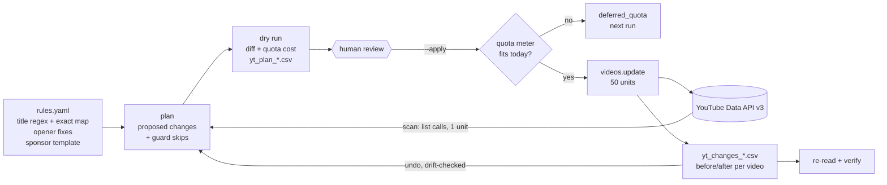
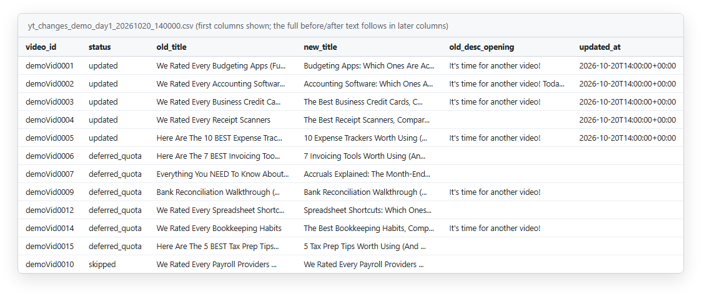

# youtube-metadata-bulk

**Bulk edits to a production system, handled like a controlled journal-entry batch: preview, approve, apply, log, and reverse if needed.**


*Dry run on the synthetic Demo Channel: 11 proposed changes, the quota cost, which ones fit today, and one rewrite a guard refused.*

## The problem

A YouTube channel's titles and descriptions are a live system of record. Viewers, search and recommendations read them all day. Say a channel has used the same title formula for years ("We Rated Every ... (Full Review)"), or pasted the same boilerplate first line into hundreds of descriptions. It needs a bulk correction. Doing that by hand in YouTube Studio gives you no preview, no batch total and no audit trail, and if you get it wrong there's no undo.

I already know how to handle that kind of change. It's a journal-entry batch: review the proposed entries, post them within a limit, keep a register of every line, and be able to reverse the batch cleanly. So I built the tool to work that way.

> **A human approves every write.** The production version updated **125 videos across 2 channels with a full change log**. This repo is a sanitized reference implementation that runs against a synthetic channel.

## What it does

- **Scans the channel first** with list calls only (1 quota unit each). It reports repeated title openings, how many titles each rule matches, how many descriptions carry the boilerplate opener and how many are missing the sponsor block.
- **Rewrites titles from rules in a YAML config.** You get exact one-off renames plus first-match-wins regex find/replace (`config/rules.example.yaml`).
- **Fixes description openers.** It removes (or replaces) a boilerplate phrase at the start of the first line and leaves the rest of the description alone.
- **Inserts a sponsor block above the timestamps.** It looks for a `Timestamps:` / `Chapters` header or the first `0:00` line, and appends at the end when there isn't one. A marker check makes it idempotent.
- **`--dry-run` is the default.** `--apply` writes. `--titles-only` and `--descs-only` narrow the batch.
- **Budgets the daily API quota.** `videos.update` costs 50 of the 10,000 daily units, which caps a run at about 200 updates a day. The tool writes what fits, defers the rest to the next run and stops *before* the API would refuse a call.
- **Writes a timestamped CSV change log** for every run: `video_id`, old/new title, old/new description opening and `updated_at`, plus the full before/after text.
- **`undo <change-log.csv>`** restores every video in a run from that log. It's a dry run unless you pass `--apply`, and it leaves alone any video someone has edited by hand since.

## Controls

| Control | How it works |
|---|---|
| **Dry run by default** | `run`, `sponsor` and `undo` only preview unless you pass `--apply`. The preview shows a red/green diff for every video plus the batch's quota cost, and writes a `yt_plan_*.csv` for review. |
| **Scan before write** | Every run starts from a fresh read of the channel. Changes are computed from what is live now, not from a stale export. |
| **Quota budget, stop before exceeding** | Each API call is charged to a meter *before* it is sent. The tool works out how many updates fit in what's left today, keeping the list calls needed to verify them. Updates beyond that are logged as `deferred_quota` and never sent. `--quota-used` and `reserve` account for other tools that share the Google Cloud project. |
| **Idempotent rules** | A title rule whose output would be rewritten again is refused at plan time. Re-running the same config proposes zero changes, so a deferred batch can be finished the next day without double edits. |
| **Sponsor block never overwrites** | The insert only splices lines in. Removing the block gives back the original byte for byte (this is a test). Descriptions that already contain the marker are skipped. |
| **Platform-limit guards** | A rewrite that would break a YouTube limit is skipped with a reason before any API call: titles over 100 characters or containing `<`/`>`, descriptions over 5,000 bytes. The description limit is checked in UTF-8 bytes, so accented text can't slip past a character count. |
| **No collateral damage** | `videos.update(part=snippet)` replaces the whole snippet, so the tool sends back tags, category and language fields unchanged and changes only the title and description. |
| **Change log as journal** | One CSV row per video (updated, deferred, failed or skipped, with the reason), flushed row by row. If a run crashes halfway, the log still holds every completed row. |
| **Verified after write** | After applying, the tool re-reads every updated video and confirms that its title and description match the log. |
| **Reversible, with drift protection** | `undo` acts only on `updated` rows, newest first, and only where the video still exactly matches what the run wrote. Hand edits made since the run are reported and left alone. Undo writes its own change log, so an undo can be undone. |
| **No secrets in code** | OAuth client and token paths come from environment variables. Tokens, client secrets, change logs and your real `config/rules.yaml` are all gitignored. Scope is `youtube.force-ssl` only. |


*Day 1 has only 300 units left, so 5 updates are written and 6 deferred. Day 2 picks up the deferred 6. Re-running the same rules then proposes zero changes.*

## Architecture



Demo and tests drive the same `YouTubeClient` adapter that production uses. In the demo, that adapter talks to `ytbulk/mock.py`, an in-memory stand-in for the API's `channels`, `playlistItems` and `videos` resources. I made the mock enforce the real API's rules: title and category are required on update, an update replaces the whole snippet, the length limits apply, and it keeps its own 10,000-unit quota. If the tool ever overran the budget, the mock would throw `quotaExceeded`. The demo ends by showing that it never did.

## Quickstart

Demo mode is fully offline. It runs the whole loop on a synthetic 15-video "Demo Channel": scan, dry run, a quota-limited day 1 apply, day 2 catch-up, an idempotent re-run, an undo with a hand-edited video, and the sponsor insert with both guards firing.

Requires Python 3.10+.

**Windows (PowerShell):**

```powershell
git clone https://github.com/markvalderrama001-svg/youtube-metadata-bulk.git
cd youtube-metadata-bulk
py -m venv .venv
.venv\Scripts\python -m pip install -r requirements.txt
.venv\Scripts\python -m ytbulk --demo
.venv\Scripts\python -m ytbulk --demo --section plan      # just the dry-run diff
.venv\Scripts\python -m pytest -q
```

<details>
<summary>macOS / Linux (bash)</summary>

```bash
git clone https://github.com/markvalderrama001-svg/youtube-metadata-bulk.git
cd youtube-metadata-bulk
python3 -m venv .venv
.venv/bin/python -m pip install -r requirements.txt
.venv/bin/python -m ytbulk --demo
.venv/bin/python -m pytest -q
```

</details>

Demo sections: `scan`, `plan`, `apply`, `rerun`, `undo`, `sponsor` (comma-separated). Change logs go to `output/demo/`.


*The day 1 change log, opened as a table (first columns, long cells shortened). Five rows are `updated` with a timestamp, six are `deferred_quota`, and one is `skipped` by the 100-character guard. The full before/after text that undo relies on is in the later columns.*

## Running against a real channel

1. In Google Cloud Console, enable **YouTube Data API v3**, create an **OAuth client ID (Desktop app)** and download the JSON into `.secrets/` (gitignored).
2. Copy `.env.example` to `.env` and set `YT_CLIENT_SECRETS_FILE`. The first run opens a browser to sign in and caches the token at `YT_TOKEN_FILE`.
3. Copy `config/rules.example.yaml` to `config/rules.yaml` and write your rules.

```powershell
.venv\Scripts\python -m ytbulk scan                                             # read-only report
.venv\Scripts\python -m ytbulk run                                              # dry run: diff + plan CSV
.venv\Scripts\python -m ytbulk run --apply --titles-only                        # write titles only
.venv\Scripts\python -m ytbulk run --apply --quota-used 1200                    # another tool already used 1,200 units today
.venv\Scripts\python -m ytbulk sponsor --recent 15                              # dry run on the 15 newest uploads
.venv\Scripts\python -m ytbulk sponsor --apply
.venv\Scripts\python -m ytbulk undo output/yt_changes_run_<timestamp>.csv       # preview the reversal
.venv\Scripts\python -m ytbulk undo output/yt_changes_run_<timestamp>.csv --apply
```

Change logs from a real channel contain real video data. They go to `output/`, which is gitignored.

## Project structure

```
ytbulk/
  __main__.py      CLI: scan, run, sponsor, undo, --demo
  rules.py         YAML config, title rules, opener fixes, sponsor insert, limit guards
  engine.py        scan report, plan, dry run / apply / verify, undo planning
  quota.py         QuotaMeter: charge-before-call, affordable-updates budget
  client.py        YouTube Data API v3 adapter + OAuth (env-var paths only)
  changelog.py     CSV change log writer / reader
  mock.py          in-memory API mock that enforces the real API's rules
  demo.py          scripted offline demo
  demo_data.py     15 synthetic videos ("Demo Channel")
config/
  rules.example.yaml
tests/             42 offline pytest tests (rules, quota stop, sponsor guards, change log, undo)
docs/              screenshots
.env.example       OAuth file paths (placeholders)
pyproject.toml     package metadata and pytest config
requirements.txt   runtime and test dependencies
```

Independent project. Not affiliated with or endorsed by YouTube or Google; names are used only to describe what the code connects to.

---

**About.** Mark Valderrama, CPA · Finance Engineer. I run the production version in my own businesses. [LinkedIn](https://www.linkedin.com/in/markvalderrama/)

MIT License, see [LICENSE](LICENSE).
